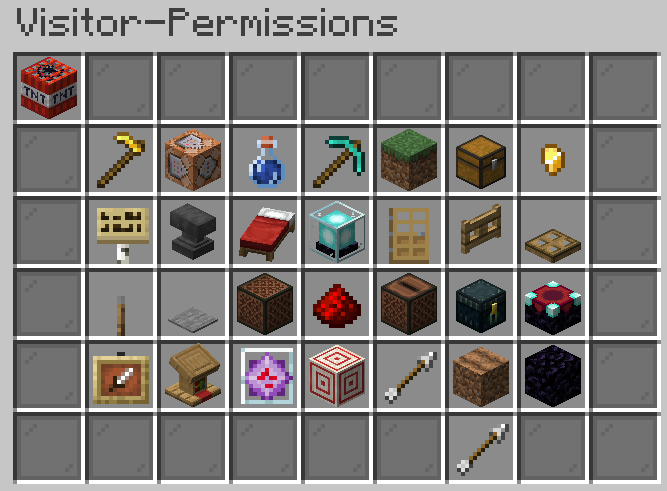

# 🛡️ Guia de Claim


Guia de como claimar uma área no Sitrus Cobblemon, com Enxada de Ouro, **/flan menu**, grupos e subclaims.


## Como claimar uma área

Para você dar Claim em uma área, adquira uma **Enxada de Ouro** através do /Kit e clique nas extremidades da área que deseja claimar.


E necessario possuir blocos de Claim o suficiente para cobrir a area desejada. Voce pode obter mais blocos de Claim, permanecendo online no servidor, ou comprando na loja de claim no Spawn.


<figure><figcaption>
Enxada de Ouro
</figcaption></figure>

Após isso, você poderá utilizar o comando **/flan menu** dentro da sua claim. Ao digitar o comando, ele abre o menu abaixo.


Lembre-se de utilizar o comando **/flan menu** **dentro** da Flan.


<figure><figcaption>
Menu Claim-Menu da Flan
</figcaption></figure>

## Itens do Menu

* **Beacon:** permissões globais, ou seja, qualquer pessoa que não esteja nos grupos da Flan.
* **Livro com pena:** permissões de grupo. Você poderá criar grupos privados, colocar o nome das pessoas e criar sub-divisões.
* **Poção de água:** editar efeitos de poções.
* **Placa:** alterar as mensagens que aparecem na tela do player ao ingressar ou sair da sua Flan.
* **Cabeça de Zumbi:** adicionar players banidos da sua Flan.
* **Estante de Livros:** abre uma lista de ações que podem ser ultrapassadas.

## Criando um Grupo

1. Abra a opção do **Livro**.
2. Clique na **Bigorna** para criar um novo grupo.
3. Coloque o nome do grupo e confirme clicando no **Papel** já com o nome desejado.
4. Depois de criar o grupo, clique com o **botão direito** no papel do grupo para abrir as permissões e configurar como quiser.

<figure><figcaption>
Tela Claim-Groups da Flan
</figcaption></figure>

<figure><figcaption>
Permissões do grupo Visitor-Permissions
</figcaption></figure>

Para adicionar um player no grupo da Flan, clique com o **botão esquerdo** no papel e depois clique na bigorna. Coloque o nome do player e confirme.

Para remover o player, clique no **bloco de redstone** e depois clique na cabeça do player.

## Criando uma Área secundária

1. Digite **/flan switchmode** para alternar para a **SubClaim**.
2. Pegue a Enxada de Ouro e selecione novamente a área.

Pronto: você criou uma área secundária que herdará as outras permissões da Flan original.

## Vídeo Explicativo

Nosso streamer **Shounen** fez um vídeo explicativo de como dar as permissões na sua claim.

[Assistir no YouTube](https://www.youtube.com/watch?v=6eqXk-FpLyk)
