# 📡 PokéNav & PokeFinder


Conteúdo criado pela Staff do Sitrus Cobblemon.


<figure><figcaption>
PokéNav
</figcaption></figure>

## PokéNav

### O que é o PokéNav?

O PokéNav é um item que auxilia os jogadores a saber a piscina de spawns dos Pokémon do bioma em que está.

As piscinas de spawn são divididas pelas raridades dos Pokémon que podem aparecer, as quais são **Comum**, **Incomum**, **Raro** e **Ultra-Raro**.

<figure>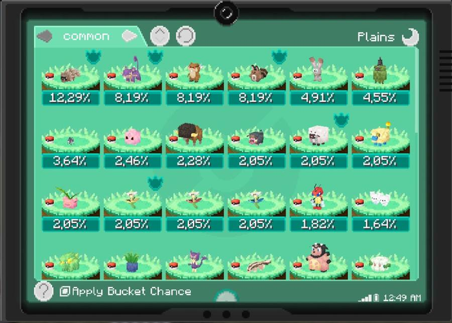<figcaption>
Piscina de spawn comum
</figcaption></figure>

<figure>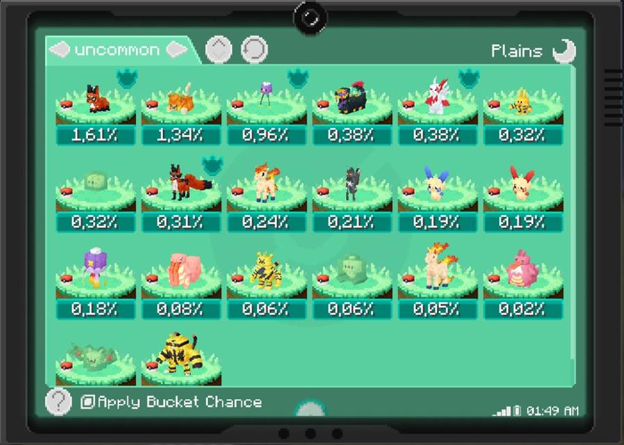<figcaption>
Piscina de spawn incomum
</figcaption></figure>

<figure>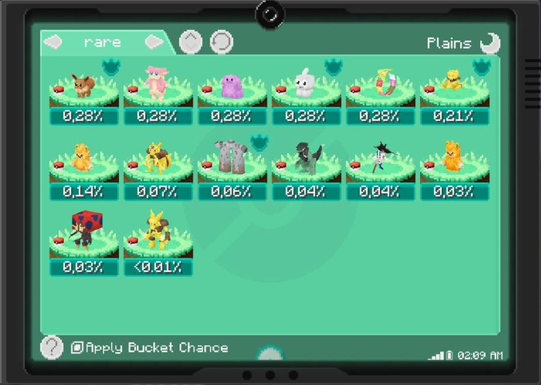<figcaption>
Piscina de spawn raro
</figcaption></figure>

<figure>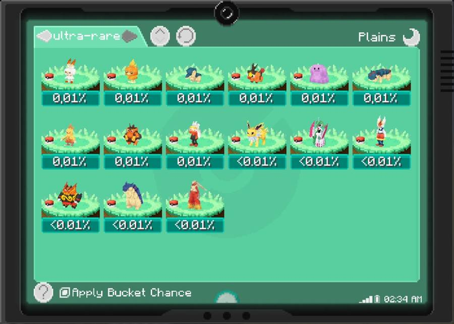<figcaption>
Piscina de spawn ultra-raro
</figcaption></figure>

### Como conseguir um PokéNav?

Você consegue craftar um PokéNav utilizando quatro barras de cobre, uma barra de ferro, uma redstone, um diamante, um Upgrade e um Electirizer.

<figure>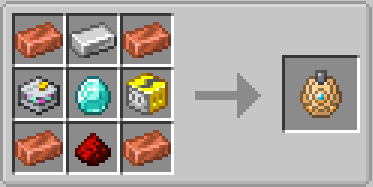<figcaption>
Receita de craft do PokéNav
</figcaption></figure>

### Modo de usar

Após você conseguir o seu PokéNav, segure ele na sua mão e pressione o botão direito do mouse para abrir o menu de spawns.

Você pode escolher a raridade que você deseja acessar pelas setas no canto superior esquerdo no menu.

### Features

#### Rastreamento de Pokémon

Caso não saiba se o Pokémon que procura já tenha spawnado ou não saiba onde ele está, você pode abrir o menu de spawns e clicar nesse ícone acima do Pokémon para habilitar uma seta que leva até o Pokémon e mostra a distância entre você e ele. Caso esse ícone não esteja acima do Pokémon procurado, ele ainda não spawnou.

<figure><figcaption>
Ícone de rastreamento do PokéNav
</figcaption></figure>

Quando um Pokémon spawna perto de você, ele é registrado no PokéNav. Ao clicar no ícone desse Pokémon dentro do menu, você consegue ver as **condições de spawn** (o que possibilita o aparecimento do Pokémon), as **anti-condições** (o que faz com que o Pokémon não apareça) e a faixa de nível que o Pokémon vai spawnar.

<figure>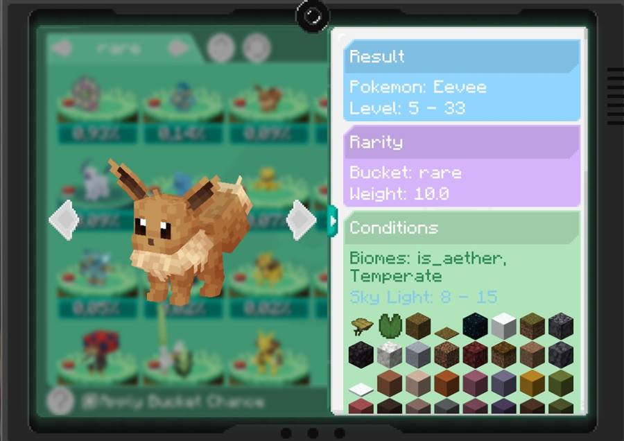<figcaption>
Condições de spawn no PokéNav
</figcaption></figure>

<figure>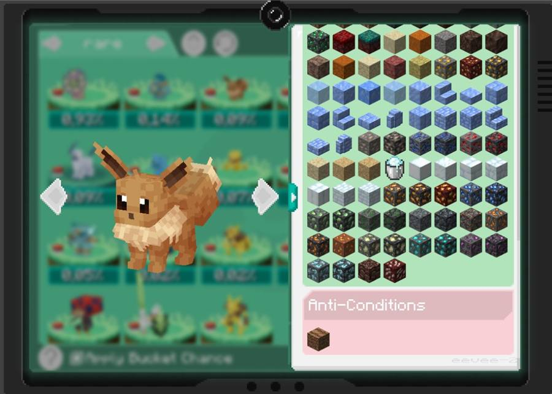<figcaption>
Anti-condições de spawn no PokéNav
</figcaption></figure>

#### Poké Snack

Ao clicar o botão direito com o PokéNav em um Poké Snack, você pode ver a chance de spawn dos Pokémon por cada mordida do Poké Snack.

<figure>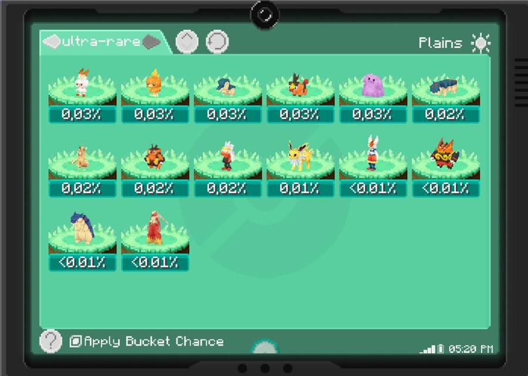<figcaption>
Chances ultra-raras sem Poké Snack
</figcaption></figure>

<figure>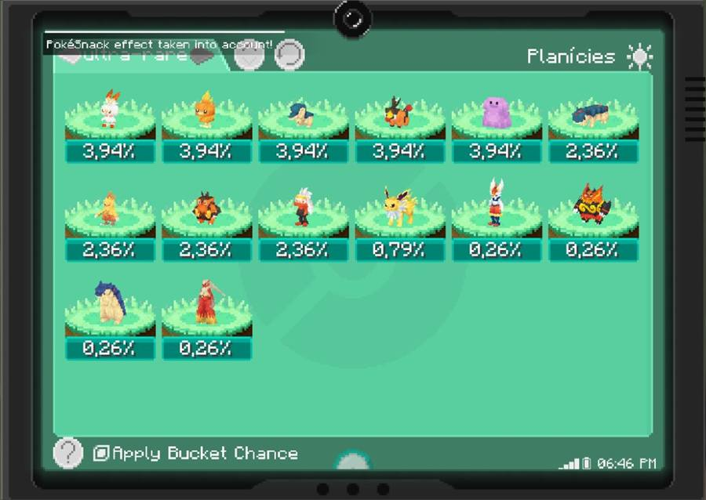<figcaption>
Chances ultra-raras com Poké Snack
</figcaption></figure>

## FishingNav

<figure>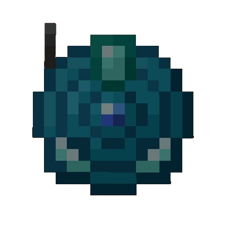<figcaption>
FishingNav
</figcaption></figure>

### O que é o FishingNav?

O FishingNav é a variante de pesca do PokéNav e possui as mesmas funcionalidades. No entanto, o uso dela com os baits das Poké Rods é diferente.

### Como utilizar?

Caso você utilize um bait na sua Poké Rod e deseje ver como ele está afetando as chances de fisgada, jogue a isca da sua vara, segure o FishingNav na sua segunda mão, pressione o shift e botão direito.

Mas cuidado: se um rastro de água aparecer enquanto você está no menu da FishingNav, ele irá fechar para que você possa fisgar o que estiver vindo para a sua isca. Caso você apenas queira ver como o bait altera a chance de spawn, jogue a isca em algum lugar que não seja água e abra o FishingNav.

## PokéFinder

<figure><figcaption>
PokéFinder
</figcaption></figure>

### O que é o PokéFinder?

O PokéFinder é um item complementar ao PokéNav. Ao segurar na mão, ele aparece como um radar no canto inferior direito da tela que mostra os Pokémon à sua volta.

Ele serve para mostrar os Pokémon que você quer encontrar à sua volta, marcando-os conforme você filtrá-los para aparecer no radar.

<figure>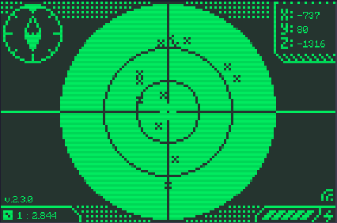<figcaption>
Radar do PokéFinder
</figcaption></figure>

### Menu de filtragem

Ao clicar com o botão direito, ele abre o menu de filtragem. Você pode filtrar por:

* Nome do Pokémon.
* Propriedades dos Pokémon.
* Rótulo dos Pokémon.
* Tipo de EV dado ao derrotar o Pokémon.
* Pokémon que você não capturou.

<figure>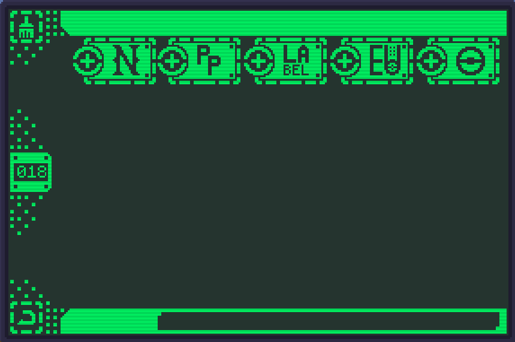<figcaption>
Menu de filtragem do PokéFinder
</figcaption></figure>

Ao clicar nesses ícones respectivamente na ordem mencionada acima, você pode adicionar um filtro para os Pokémon que são marcados no mapa.

<figure><figcaption>
Ícones de filtro do PokéFinder
</figcaption></figure>

#### Nome

Escrevendo o nome de um Pokémon específico, apenas ele irá marcar no radar.

<figure><figcaption>
Filtro de nome do PokéFinder
</figcaption></figure>

#### Propriedades

Aqui você pode escrever tags específicas do Pokémon, como forma regional, piscina de spawn, Region Bias (Pokémon que podem evoluir para uma forma regional) e formas.

<figure><figcaption>
Filtro de propriedades do PokéFinder
</figcaption></figure>

#### Rótulos

Aqui você pode colocar rótulos, que são:

* Paradox
* Ultra Beast
* Starter
* gen1 → 9
* Fossil
* Powerhouse

<figure><figcaption>
Filtro de rótulos do PokéFinder
</figcaption></figure>

#### Tipo de EV

Aqui você pode selecionar o tipo de EV que os Pokémon à sua volta dão. Por exemplo, selecionando o EV de **SPE**, apenas os Pokémon que dão EVs de velocidade quando derrotados serão marcados.

<figure><figcaption>
Filtro de tipo de EV do PokéFinder
</figcaption></figure>

#### Não-Capturados

Essa opção faz com que apenas os Pokémon não registrados na sua Pokédex apareçam no radar.

<figure><figcaption>
Filtro de Pokémon não capturados
</figcaption></figure>
