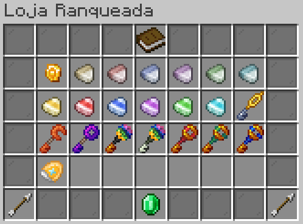

# 🪙 Moedas e Economia


Olá, Treinador. Aqui estão as moedas do servidor, como usá-las e onde conseguir cada uma.


Você deve ter notado que usamos moedas especiais no nosso servidor. Aqui irei lhe apresentar quais moedas existem, como usá-las e onde adquirir cada uma delas.

## Como saber suas moedas

Para você saber quanto possui de cada moeda, use o comando **/carteira**.

<figure><figcaption>
Menu do comando /carteira com Sitrus Coins, Cristais, Pontos, Troféus, Moeda dos Exploradores e Fragmentos
</figcaption></figure>

Ao utilizar o comando **/carteira**, um menu surge mostrando quanto você possui de cada moeda.

Algumas moedas podem não estar disponíveis para serem ganhas no servidor. Estas provavelmente entram em atualizações futuras, ou serão retiradas nestas atualizações.

Você pode usar o comando **/baltop** para ver o top 10 de cada moeda. Use o complemento de nome para trocar o ranking. Exemplo: **/baltop --currency moeda\_exploradores**.

Para pagar Sitrus Coin a outro jogador, use **/pay valor Nome**, nesta ordem. Assim dá para negociar fora do GTS.

## Sitrus Coin

A primeira e principal moeda do servidor. É obtida através de vendas, tanto de Pokémon quanto de plantações, além de eventos, missões e outros. Serve para compra de itens (Held Items) e negociações via GTS.

<figure><figcaption>
Interface da loja A Loja, ID 001
</figcaption></figure>

## Cristais

Disponíveis após a atualização da 1.8.

## Pontos

Disponíveis após a atualização da 1.8.

## Troféus

A moeda da Ranqueada. Você a obtém após batalhar na Arena Ranqueada. Estes troféus podem ser utilizados na Loja Ranqueada para obter itens como os Doces de IV, Adesivo Dourado e Chaves de Lendário. Esta moeda não pode ser negociada entre os players.

<figure><figcaption>
Loja Ranqueada com doces, chaves e itens
</figcaption></figure>

## Moedas dos Exploradores

A moeda obtida através de missões, Raids de Cristal e Global, além de eventos, ou sendo comprada na Loja Ranqueada. Esta é a moeda mais importante atualmente. Com ela é possível obter itens de forma, itens de mecânica, Mega Pedras e os próprios Pokémon Lendários.

Esta moeda pode ser negociada através da compra no Gerente do Banco, que se localiza na Ordem dos Exploradores, com uma pequena taxa de conversão da moeda na carteira para a moeda física.

## Fragmentos

Disponíveis após a atualização da 1.8.

## Economia

A economia no servidor segue um padrão específico para cada tipo de moeda. Aqui vai o básico sobre como obter cada tipo e o método mais eficaz.

### Sitrus Coin

O método mais eficaz de obter esta moeda é através do STS. Dá para capturar Pokémon aleatório e vender no STS, até se obter uma quantidade de dinheiro e investir em máquinas de breeding. A venda de Pokémon F5 ou F6 de raridade alta pode render até **63.000** Sitrus Coins por venda, se tornando o melhor farm de Sitrus Coin atual. Também dá para investir em plantações, trabalhos para players mais ricos e venda de Pokémon breedados no GTS, complementando ainda mais a renda de Sitrus Coin.

### Cristais

Será adicionado na atualização da 1.8.

### Pontos

Será adicionado na atualização da 1.8.

### Troféus

O melhor método para obter grandes quantidades de troféus é investir em batalhas na ranqueada, sem se preocupar com o elo. Quanto mais batalhas, maior a quantidade de troféus. Mesmo que haja mais derrotas, é inevitável obter mais troféus desta forma do que poupando o elo e deixando de batalhar.

### Moedas dos Exploradores

A moeda dos exploradores pode ser facilmente obtida através das missões repetitivas. Escolha missões de vários níveis diferentes, com objetivos simples e similares, que possam ser cumpridas ao mesmo tempo. Desta forma você gasta menos recurso para cumprir uma quantidade maior de missões. Inclua neste método missões que envolvam captura e derrota de Pokémon, e aproveite a Raid de Cristal, que dropa uma pequena quantidade de moedas, para cumprir as duas coisas ao mesmo tempo. Não se esqueça de participar de todos os eventos disponíveis, pois de lá vêm grandes quantias de moedas.

### Fragmentos

Será adicionado na atualização 1.8.
