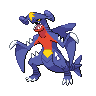

# ⚔️ Tabela de Tipos


Escolha o **tipo do seu golpe** na primeira coluna e veja contra quem ele é forte ou fraco. Exemplo: **Fogo** causa o dobro em Grama, Gelo, Inseto e Aço.


## 🎯 STAB

**STAB** dá **1.5×** quando o golpe tem o mesmo tipo do Pokémon. Super efetivo + STAB vira **3×**. Fraqueza quádrupla + STAB chega a **6×**.

.png>)

**Charizard + Flamethrower**

STAB 1.5×. Contra Grama: **3.0×**.

**Garchomp vs Gelo**

Fraqueza 4× de Gelo. Com STAB no golpe: **6.0×**.

## 📋 Lista por tipo

Escolha o tipo do seu golpe e veja contra quem ele é forte ou fraco.

| Tipo do seu golpe | Causa o dobro (2×) em          | Causa metade (½×) em                         | Não acerta (0×) | Você recebe o dobro de         | Você resiste a                                                 | Você é imune a |
| ----------------- | ------------------------------ | -------------------------------------------- | --------------- | ------------------------------ | -------------------------------------------------------------- | -------------- |
| Normal            | —                              | Pedra Aço                                    | Fantasma        | Lutador                        | —                                                              | Fantasma       |
| Fogo              | Grama Gelo Inseto Aço          | Fogo Água Pedra Dragão                       | —               | Água Terra Pedra               | Fogo Grama Gelo Inseto Aço Fada                                | —              |
| Água              | Fogo Terra Pedra               | Água Grama Dragão                            | —               | Elétrico Grama                 | Fogo Água Gelo Aço                                             | —              |
| Grama             | Água Terra Pedra               | Fogo Grama Veneno Voador Inseto Dragão Aço   | —               | Fogo Gelo Veneno Voador Inseto | Água Grama Elétrico Terra                                      | —              |
| Elétrico          | Água Voador                    | Grama Elétrico Dragão                        | Terra           | Terra                          | Elétrico Voador Aço                                            | —              |
| Gelo              | Grama Terra Voador Dragão      | Fogo Água Gelo Aço                           | —               | Fogo Lutador Pedra Aço         | Gelo                                                           | —              |
| Lutador           | Normal Gelo Pedra Sombrio Aço  | Veneno Voador Psíquico Inseto Fada           | Fantasma        | Voador Psíquico Fada           | Inseto Pedra Sombrio                                           | —              |
| Veneno            | Grama Fada                     | Veneno Terra Pedra Fantasma                  | Aço             | Terra Psíquico                 | Grama Lutador Veneno Inseto Fada                               | —              |
| Terra             | Fogo Elétrico Veneno Pedra Aço | Grama Inseto                                 | Voador          | Água Grama Gelo                | Veneno Pedra                                                   | Elétrico       |
| Voador            | Grama Lutador Inseto           | Elétrico Pedra Aço                           | —               | Elétrico Gelo Pedra            | Grama Lutador Inseto                                           | Terra          |
| Psíquico          | Lutador Veneno                 | Psíquico Aço                                 | Sombrio         | Inseto Fantasma Sombrio        | Lutador Psíquico                                               | —              |
| Inseto            | Grama Psíquico Sombrio         | Fogo Lutador Veneno Voador Fantasma Aço Fada | —               | Fogo Voador Pedra              | Grama Lutador Terra                                            | —              |
| Pedra             | Fogo Gelo Voador Inseto        | Lutador Terra Aço                            | —               | Água Grama Lutador Terra Aço   | Normal Fogo Veneno Voador                                      | —              |
| Fantasma          | Psíquico Fantasma              | Sombrio                                      | Normal          | Fantasma Sombrio               | Veneno Inseto                                                  | Normal Lutador |
| Dragão            | Dragão                         | Aço                                          | Fada            | Gelo Dragão Fada               | Fogo Água Grama Elétrico                                       | —              |
| Sombrio           | Psíquico Fantasma              | Lutador Sombrio Fada                         | —               | Lutador Inseto Fada            | Fantasma Sombrio                                               | Psíquico       |
| Aço               | Gelo Pedra Fada                | Fogo Água Elétrico Aço                       | —               | Fogo Lutador Terra             | Normal Grama Gelo Voador Psíquico Inseto Pedra Dragão Aço Fada | Veneno         |
| Fada              | Lutador Dragão Sombrio         | Fogo Veneno Aço                              | —               | Veneno Aço                     | Lutador Inseto Sombrio                                         | Dragão         |
